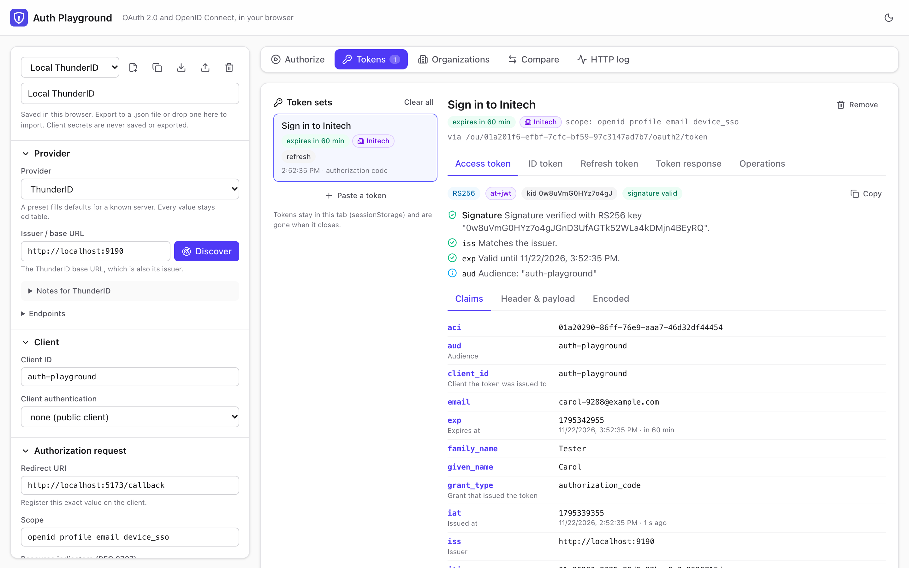
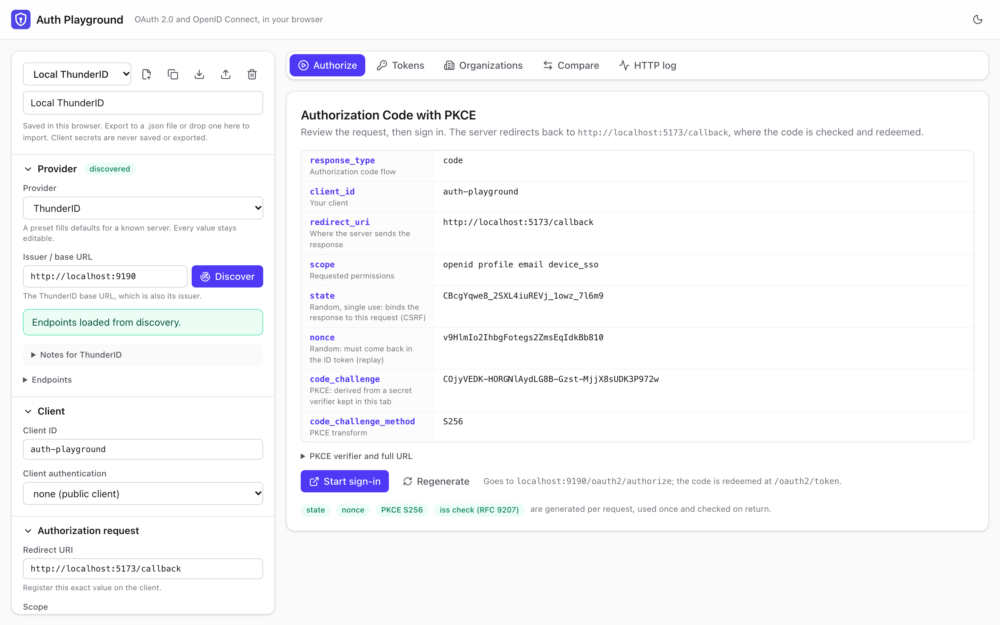
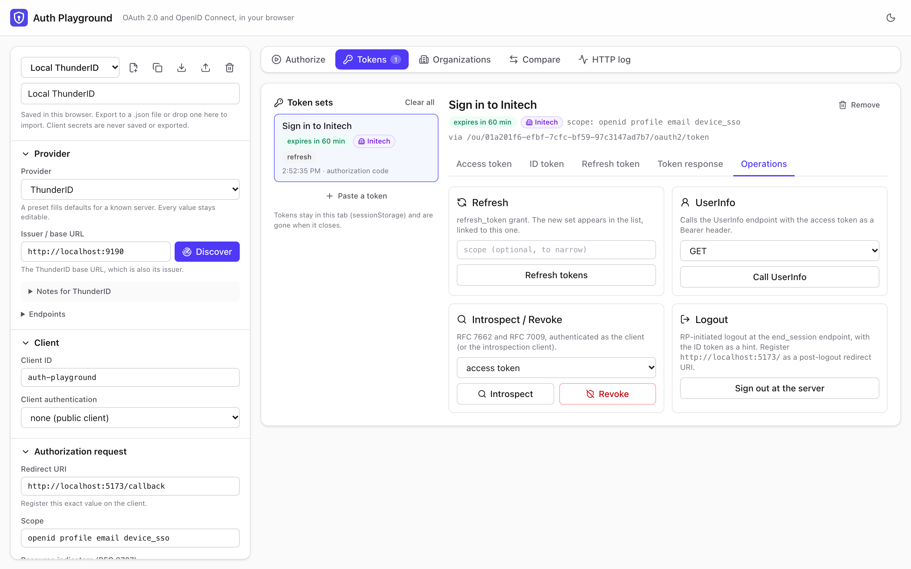
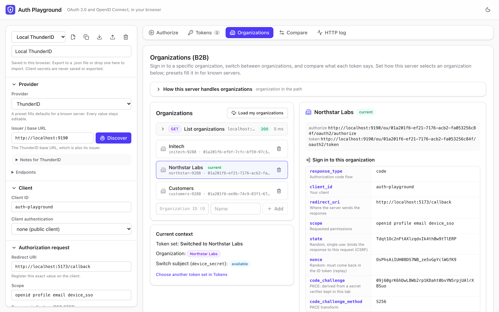
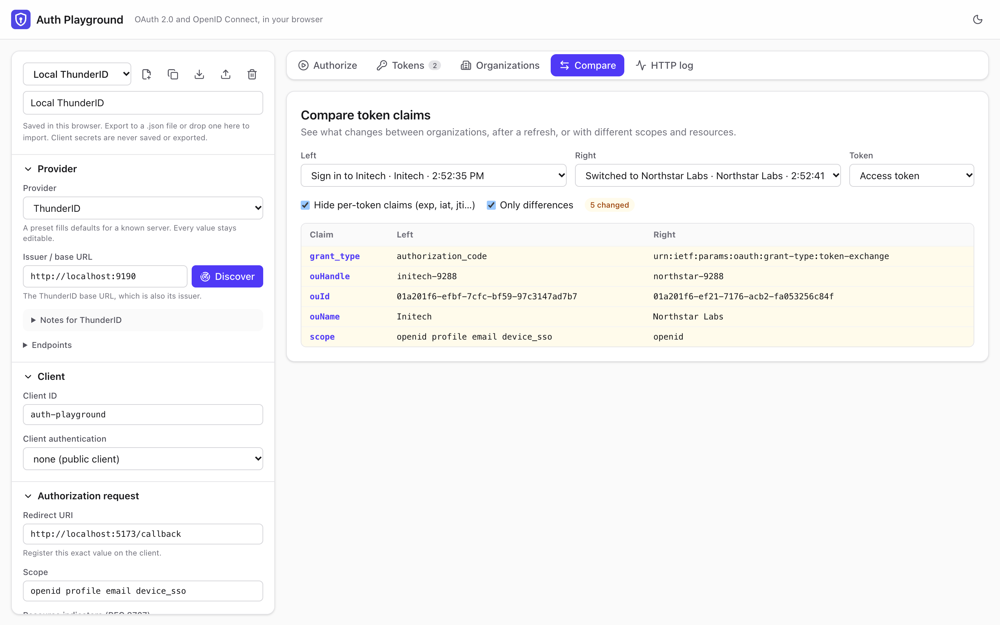
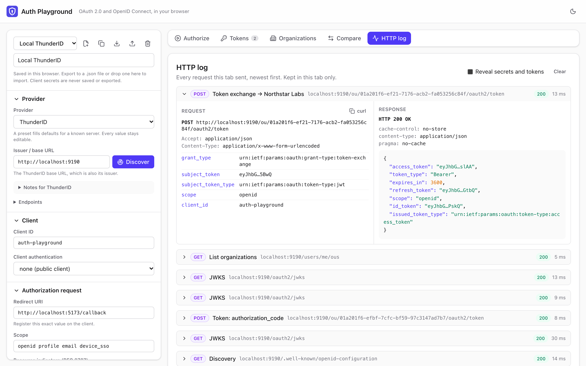
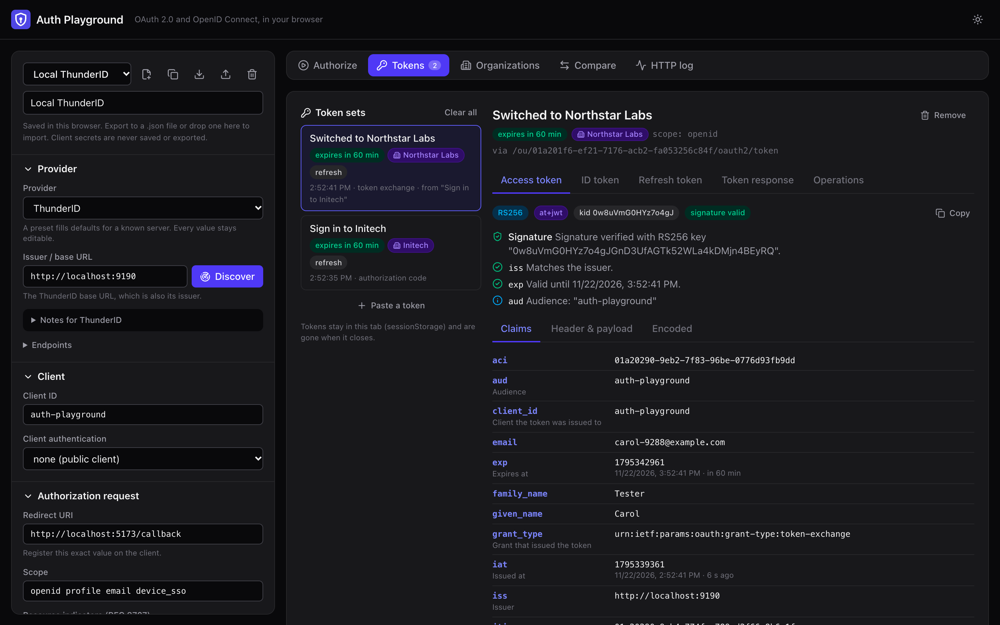

# Auth Playground

A browser-only OAuth 2.0 and OpenID Connect test bench for any standards-based authorization server. Inspired by OIDC Debugger, with token operations, organization (B2B) testing and a full HTTP log. Provider presets fill in defaults for known servers; [ThunderID](https://thunderid.dev) is the first preset and the server it is tested against.

Live: <https://auth-playground.yeshandev.com>



## What it does

- **Authorization Code with PKCE, one step at a time**: discovery, configurable endpoints, scopes (with chips from `scopes_supported`), RFC 8707 resources, prompt, max_age, login_hint, acr_values, ui_locales and any extra parameter. The request is editable JSON: change, add or remove any parameter; state, nonce and the PKCE challenge are generated for each sign-in. Optionally push the request first (PAR, RFC 9126) and see the `request_uri` and its expiry before signing in.
- **Sign-in in its own tab**: each sign-in opens a new tab, and the response comes back to the playground, so its state stays put and several sign-ins can run at once. A Sign-ins list follows each one from waiting to code, tokens or error.
- **Callback checks**: single-use state, `iss` (RFC 9207), errors explained in plain words. The code is removed from the address bar at once. Then you decide: open the token request, which shows the exact request and lets you edit its URL, body and headers before sending; copy it as curl; or discard the code. Automatic redemption is a setting.
- **Tokens**: decoded access, ID and refresh tokens; JWKS signature check (RS, PS, ES, EdDSA); ID token checks (iss, aud, azp, exp, nbf, iat, nonce, at_hash, c_hash); claim descriptions and times.
- **Operations**: refresh, UserInfo (GET or POST), introspection, revocation (confirmed by introspection), RP-initiated logout.
- **Other grants**: client credentials (with this configuration's client or another, confidential one), device authorization (RFC 8628: user code, verification link, polling with `slow_down` and expiry), and token exchange (RFC 8693: subject and actor tokens picked from any token set or pasted, requested token type, audience, resource, scope). Any of them can target an organization's token endpoint, and the tokens they return get every operation.
- **Organizations (B2B)**: the organization goes in the endpoint path (`{issuer}/o/{org}/authorize`) or in a request parameter (`organization=...`), with configurable organization claims. Sign in to an organization, redeem at its token endpoint, switch silently with `prompt=none` or by token exchange (RFC 8693), list the user's organizations, and compare claims between any two token sets.
- **Provider presets**: Generic OAuth 2.0 / OpenID Connect, and ThunderID. A preset fills organization handling, claim names and placeholders, and shows notes about the server. Every value stays editable.
- **HTTP log**: every request and response, secrets masked unless revealed, copy as curl.
- **First-run setup**: a new configuration asks for the issuer URL and client ID only; everything else comes from discovery. A preset that knows its server's paths (ThunderID) fills the base URL and the endpoints from it, so it works without discovery too; endpoints you change stay when the base URL changes. Switch configurations from the header; the full configuration, with every section open, is under Server settings.
- **Saved configurations** in `localStorage`. Export one or all of them to a `.json` file, and import by choosing a file or dropping it on Server settings. Client secrets are never saved or exported.

## Screenshots

| | |
|---|---|
|  |  |
| **Authorize**: the request, every parameter explained, PKCE generated per request. | **Operations**: refresh, UserInfo, introspection, revocation and logout, with the exchange. |
|  |  |
| **Organizations**: the user's organizations, sign-in to one, switch by token exchange. | **Compare**: what changes between two token sets. |
|  |  |
| **HTTP log**: every request and response, secrets masked, copy as curl. | **Dark theme**. |

Screenshots are from a local ThunderID server with test data.

## Security model

- Configurations hold no secrets. Secrets typed for confidential test clients live in memory for the tab only.
- Tokens, unredeemed codes and the HTTP log live in `sessionStorage`: this tab only, gone when it closes. The saved log has client secrets redacted, and "copy as curl" writes `$CLIENT_SECRET` in their place unless you reveal secrets.
- Requests go only to absolute http(s) endpoints, so an incomplete endpoint never sends a token anywhere.
- State, nonce and the PKCE verifier are random per request and single use.
- Back-channel calls omit cookies. Pages send no Referer, carry a strict Content-Security-Policy (scripts from this origin only), and refuse to run inside a frame.
- Nothing is sent anywhere except the servers you configure. No analytics, no backend.

Use test clients and test users. A browser is not the place for production client secrets.

## Using it

1. Register a client with redirect URI `https://auth-playground.yeshandev.com/callback` (and post-logout redirect URI `https://auth-playground.yeshandev.com/` for logout). A public client with PKCE is the natural fit for a browser.
2. Allow the playground's origin in the server's CORS settings, so the browser can call the token, UserInfo, introspection and revocation endpoints.
3. Pick a provider preset, enter the issuer or base URL, press **Discover**, enter the client ID and sign in.

## Provider notes: ThunderID

Choose the **ThunderID** preset and enter the server's base URL (for example `https://localhost:8090`).

1. **Allow the playground's origin** in the server-wide CORS list. On the standalone (gateway) server the list is set by file, not by API: create `config/resources/server_configs/cors.yaml` in the server folder and restart.

   ```yaml
   resource_type: server_config
   name: cors
   value:
     allowedOrigins:
       - "https://auth-playground.yeshandev.com"
       - "http://localhost:5173"
   ```

2. **Create a browser application**: public client, token endpoint authentication `none`, PKCE required, grants `authorization_code` and `refresh_token` (add token exchange for the device-secret switch, and the device code grant with a device grant flow for device authorization). For client credentials, create a separate `m2m` application with `client_secret_post`. Redirect URI `https://auth-playground.yeshandev.com/callback`, post-logout redirect URI `https://auth-playground.yeshandev.com/`. For organizations, add `ouId`, `ouName` and `ouHandle` to the access token attributes and share the application with the organizations.

`scripts/thunderid-setup.sh` does steps 1 and 2 against a running server. It also creates two organizations, test users, a device grant flow for the browser application, and a confidential `-m2m` client for client credentials:

```bash
BASE=https://localhost:8090 ADMIN_PASSWORD='<admin password>' PACK_DIR=/path/to/thunderid ./scripts/thunderid-setup.sh
```

### Local server notes

- A local ThunderID uses a self-signed certificate. Open the server URL in a tab and trust it once, or run the server with `server.http_only: true` for local testing.
- Chrome asks for permission before a public site (the hosted playground) calls `localhost`. Allow it, or run the playground locally (`npm run dev`).

### Behaviour the preset accounts for

| Topic | Behaviour |
|---|---|
| Token endpoint and CORS | `/oauth2/token` answers no preflight, so `client_secret_basic` (an `Authorization` header) cannot be used from a browser. Use `none` or `client_secret_post`. |
| PKCE | `S256` only. |
| PAR | `/oauth2/par` works from the browser as a simple request. A `request_uri` lasts 60 seconds, so sign in soon after pushing. Organization sign-ins push to the same endpoint. |
| Response mode | `query` only. |
| Organizations | Selected by path: `/ou/{ouId}/oauth2/authorize` and `/ou/{ouId}/oauth2/token`. |
| Organization token endpoint | Accepts authorization code, client credentials and token exchange (device secret only). Refresh goes to `/oauth2/token`; the refresh token keeps the organization. |
| Shared applications | A sign-in to a shared application must decide the organization. Without an OU resolver in the flow, a sign-in at `/oauth2/authorize` is refused with `access_denied`. |
| Silent switch | `prompt=none` reuses the SSO session when the flow keeps one; responses forbid framing, so the playground uses a top-level redirect. |
| Revocation | Answers 200 for unknown tokens too; the playground confirms with introspection. |

See [docs/ARCHITECTURE.md](docs/ARCHITECTURE.md) for the research, the backend matrix and the design.

## Development

```bash
npm install
npm run dev      # http://localhost:5173
npm test         # unit tests (Vitest)
npm run lint
npm run build    # dist/, with / and /callback/ entries
```

The app is static. `.github/workflows/deploy.yml` builds and publishes it to GitHub Pages on every push to `main`; `public/CNAME` sets the custom domain. Set `BASE_PATH=/repo-name/` when building for a project page without a custom domain.

## Roadmap

CIBA, signed request objects (JAR), DPoP, `private_key_jwt`, more provider presets, shareable configuration links, and an optional self-hosted relay for servers without CORS.
